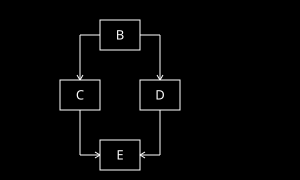

# How the Flows compiler works

## Type system

The type system is simple:

* structs (named sequence of fields)
* oneof types (typesafe unions, same in purpose as std::variant)
* arrays (only one level at field level for reasons described below)
* bit

C chose to spell array types in the order they're indexed ("declaration mirrors use"), so <code>int[5][10]</code> is indexed as <code>t[i][j]</code> with i < 5. The
cost is that substituting a typedef's definition no longer gives the same type. You can't have both orders at once, and C picked indexing.

Flows avoids the question by not allowing nested arrays: each level is wrapped in a named struct, so construction and access read the same way
(<code>table.Rows[i].Values[j]</code>). Protocol Buffers has a similar rule (a repeated field can't directly contain another repeated field), and C++'s
<code>std::array&lt;std::array&lt;int, 10&gt;, 5&gt;</code> composes by substitution for the same reason. The cost is some verbosity for genuinely
multi-dimensional data such as matrices, which a shorthand could address later if the verbosity proves to be excessive.

## Syntax

Syntax borrows from a mix of languages, borrowing core (expressions/statements) from C and extending it with named parameters
(to avoid accidentally swapping parameters such as offset and length).

## Abstract Syntax Tree for transform in Flows

<pre>
Statement =
  StatementVariableDeclaration(Name name, Type type, Expression value) |
  StatementExpression(Name? target, Expression value) |
  StatementIfWhile(Kind kind, Expression condition, Block then, Block? else) |          // kind: If | While
  StatementLoopControl(Kind kind) |                                                     // kind: Break | Continue
  StatementStep

Block = Block(Statement* statements)

Expression =
  ExpressionConstant(value) |
  ExpressionName(name) |
  ExpressionPart(Expression sub, Name field) |                                          // object.field
  ExpressionIs(Expression sub, Type type) |                                             // object is TypeOption
  ExpressionUnary(Negated, Expression sub) |
  ExpressionBinary(Kind, Expression a, Expression b) |                                  // ==, !=, &&, ||, ...
  ExpressionFunction(name, Expression* positional, (Name: Expression)* named) |
  ExpressionObject(Type type, (Name: Expression)* fields)
</pre>

## Example of control flow graph illustrated on a small program block

<pre>
[statement A] step;
[statement B] if (x) {
[statement C]   y = V1;
[           ] } else {
[statement D]   y = V2;
[           ] }
[statement E] y = y+1;
[statement F] step;
</pre>

It is important to note that statements are really a convenient mental model of the program construction but it does
not reflect what happens in FPGA. In FPGA, the current state is taken at the boundary of the clock cycle (marked
by <code>step</code> keyword) from the registers, all of accumulated effects of the step are applied to the state to
calculate next state combinatorially and next state is then saved to the registers.

The central problem that compiler faces is figuring out the values of variables when conditional branches converge
(known in compiler literature as gamma function of gated single assignment form). CPU avoids this problem by
simply producing side effects (such as changing value of register/memory) only for one branch by skipping the other
branch but FPGA works differently - it always calculates every possible value and then picks the value based on the
condition. Flows compiler needs to accumulate the effects of statements and express the accumulated effects into a
unified formula.

For example above, the compiler needs to answer the question "what is the accumulated value of <code>y</code> at
statement E?" It depends on condition <code>x</code>; in this simple if/else case it's easy to see that it's
<code>V1</code> if <code>x</code> and <code>V2</code> otherwise but in general case where branches converge in more
complex ways there a general algorithm is required for building a formula for accumulated value of <code>y</code>.

The solution lies in enumerating which chains of branches/statements reach the statement in question. In this case,
the chains are B → C → E and B → D → E. What compiler does is build reachability graphs that describe which sets of
branching decisions lead to the statement - for <code>C</code> the graph is <code>conditionAtB ? REACHABLE : NOT_REACHABLE</code>,
for <code>D</code> the graph is <code>conditionAtB ? NOT_REACHABLE : REACHABLE</code>. For <code>E</code> these graphs are merged into
<code>conditionAtB ? REACHABLE : REACHABLE</code> (or, simplified, <code>REACHABLE</code>).

It then takes the value at each predecessor node (in case of <code>E</code>, <code>C</code> and <code>D</code>), replaces
<code>REACHABLE</code> token with value at that predecessor and merges them:

<pre>
ContributionOfC: conditionAtB ? ValueAtC : NOT_REACHABLE
ContributionOfD: conditionAtB ? NOT_REACHABLE : ValueAtD
</pre>

When merged, it results in the formula <code>conditionAtB ? ValueAtC : ValueAtD</code>. This algorithm works for any acyclic
control flow graph (see next section for why). The references on the right side of assignment are resolved by simply walking
up the control flow graph until either assignment of variable in question is encountered or a merge point (statement with
more than one predecessor).

The compiler then emits the formulas for value of each variable at each assignment statement and each merge point, chaining
them together to build the overall formula for the value that each variable ends up with at the end of each step. These
intermediate formulas are then merged to arrive at the complete formula that gives new value for any step.

## Why all Flows control flow graphs are acyclic

Don't loops create cycles in the control flow graph? Ordinarily they would but Flows imposes a constraint on the program:
no statement other than <code>step</code> is allowed to reach itself without going through <code>step</code> statement. The
reason for this constraint is that allowing that would make it possible to write programs that require accumulating effects of
potentially unbound number of iterations of the loop in a single cycle - this is impossible to implement in FPGA
(implementing it would require a combinatorial loop that would break the propagation of data through the FPGA cells so
Vivado rejects it). For practical purposes it means that every loop must contain at least one <code>step</code> statement
and no <code>continue</code> statements before that <code>step</code> statement (these are basic examples, the precise rule
is that no statement other than <code>step</code> is allowed to reach itself without going through <code>step</code> statement).

Bounded loops could potentially be supported but it hasn't been prioritized at this point.
