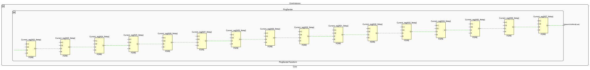

# Difference between how CPU and FPGA execute programs

Consider the GCD example:

<pre>
uint32_t gcd(uint32_t a, uint32_t b) {
  while (a != b) {
    if (a > b) {
      a = a-b;
    } else {
      b = b-a;
    }
  }
  return a | b;
}
</pre>

G++ generates the following code from it:

<pre>
   0x0000000000001180 <+0>:  cmp    %esi,%edi
   0x0000000000001182 <+2>:  je     0x119e <_Z3gcdjj+30>
   0x0000000000001184 <+4>:  nopl   0x0(%rax)                          // alignment no-op to align jump target address to 8 bytes
   0x0000000000001188 <+8>:  cmp    %edi,%esi
   0x000000000000118a <+10>: jae    0x1198 <_Z3gcdjj+24>
   0x000000000000118c <+12>: sub    %esi,%edi
   0x000000000000118e <+14>: cmp    %edi,%esi
   0x0000000000001190 <+16>: jne    0x1188 <_Z3gcdjj+8>
   0x0000000000001192 <+18>: mov    %esi,%eax
   0x0000000000001194 <+20>: ret    
   0x0000000000001195 <+21>: nopl   (%rax)                             // alignment no-op to align jump target address to 8 bytes
   0x0000000000001198 <+24>: sub    %edi,%esi
   0x000000000000119a <+26>: cmp    %esi,%edi
   0x000000000000119c <+28>: jne    0x1188 <_Z3gcdjj+8>
   0x000000000000119e <+30>: mov    %edi,%eax
   0x00000000000011a0 <+32>: ret    
</pre>

The state here is <code>ESI</code>, <code>EDI</code> and <code>RIP</code>. What the CPU does is fetch the next instruction, execute it, and repeat.

The same algorithm in Flows, as part of a small calculator that also multiplies (GCD is on lines 26–40):

<pre>  1  

struct

 MultiplyRequest 

{

 A

:

 Bit

[

32

]

;

 B

:

 Bit

[

32

]

;

 

}

  2  

struct

 GCDRequest 

{

 A

:

 Bit

[

32

]

;

 B

:

 Bit

[

32

]

;

 

}

  3  

oneof

 CalculatorRequest 

{

 MultiplyRequest

,

 GCDRequest 

}

  4  

struct

 CalculatorResult 

{

 Value

:

 Bit

[

32

]

;

 

}

  5  

oneof

 BlankOrCalculatorResult 

{

 Blank

,

 CalculatorResult 

}

  6  

  7  

transform

 CalculatorTransform 

(

Request

:

 CalculatorRequest

,

 Response

:

 BlankOrCalculatorResult

)

 

{

  8  
    

while

 

(

true

)

 

{

  9  
        

if

 

(

RequestReader 

is

 CalculatorRequest

)

 

{

 10  
            RequestPop 

=

 1

;

 11  
            

if

 

(

RequestReader

.

CalculatorRequest 

is

 MultiplyRequest

)

 

{

 12  
                Bit

[

32

]

 Product 

=

 0

;

 13  
                Bit

[

32

]

 MultiplyA 

=

 RequestReader

.

CalculatorRequest

.

MultiplyRequest

.

A

;

 14  
                Bit

[

32

]

 MultiplyB 

=

 RequestReader

.

CalculatorRequest

.

MultiplyRequest

.

B

;

 15  
                

step

;

 16  
                

while

 

(

MultiplyB 

!=

 0

)

 

{

 17  
                    

if

 

(

Slice

(

whole

:

 MultiplyB

,

 offsetInBits

:

 0

,

 countInBits

:

 1

)

 

==

 1

)

 

{

 18  
                        Product 

=

 Product 

+

 MultiplyA

;

 19  
                    

}

 20  
                    MultiplyA 

=

 ShiftLeft

(

what

:

 MultiplyA

,

 howManyBits

:

 1

)

;

 21  
                    MultiplyB 

=

 ShiftRight

(

what

:

 MultiplyB

,

 howManyBits

:

 1

)

;

 22  
                    

step

;

 23  
                

}

 24  
                Response 

=

 CalculatorResult

{

Value

:

 Product

}

;

 25  
            

}

 

else

 

{

 26  
                

if

 

(

RequestReader

.

CalculatorRequest 

is

 GCDRequest

)

 

{

 27  
                    Bit

[

32

]

 GCDA 

=

 RequestReader

.

CalculatorRequest

.

GCDRequest

.

A

;

 28  
                    Bit

[

32

]

 GCDB 

=

 RequestReader

.

CalculatorRequest

.

GCDRequest

.

B

;

 29  
                    

if

 

(

GCDA 

!=

 0 

&amp;&amp;

 GCDB 

!=

 0

)

 

{

 30  
                        

step

;

 31  
                        

while

 

(

GCDA 

!=

 GCDB

)

 

{

 32  
                            

if

 

(

GCDA 

&gt;

 GCDB

)

 

{

 33  
                                GCDA 

=

 GCDA

-

GCDB

;

 34  
                            

}

 

else

 

{

 35  
                                GCDB 

=

 GCDB

-

GCDA

;

 36  
                            

}

 37  
                            

step

;

 38  
                        

}

 39  
                    

}

 40  
                    Response 

=

 CalculatorResult

{

Value

:

 GCDA 

|

 GCDB

}

;

 41  
                

}

 42  
            

}

 43  
        

}

 44  
        

step

;

 45  
    

}

 46  

}

 47  

 48  

system

 

{

 49  
    

instance

 Calculator

:

 CalculatorTransform

;

 50  
    

queue

 HostMessageRouter

.

ToCalculator 

-&gt;

 Calculator

.

Request

;

 51  
    

wire

 Calculator

.

Response 

-&gt;

 HostMessageRouter

.

FromCalculator

;

 52  

}

 53  

</pre>

On an FPGA, there is no sequence of instructions stored in RAM. Instead, Flows generates the following set of formulas
that describe next value for each register:

<pre>
Condition1 = RequestReader is CalculatorRequest
Condition2 = RequestReader.CalculatorRequest is GCDRequest
Condition3 = GCDA != GCDB
Condition4 = GCDA > GCDB

Next GCDA =
  RequestReader.CalculatorRequest.GCDRequest.A if (currently at beginning or line 44) and Condition1 and Condition2
  GCDA-GCDB if (currently at line 30 or 37) and Condition3 and Condition4
  GCDA otherwise
Next GCDB =
  RequestReader.CalculatorRequest.GCDRequest.B if (currently at beginning or line 44) and Condition1 and Condition2
  GCDB-GCDA if (currently at line 30 or 37) and Condition3 and !Condition4
  GCDB otherwise
</pre>

The state here is <code>GCDA</code>, <code>GCDB</code>, <code>Currently at beginning</code>, <code>Currently at line
30</code>, <code>Currently at line 37</code> and <code>Currently at line 44</code>. Lines 30, 37 and 44 are the `step`
statements, where the program waits for the next clock cycle; "currently at line 30" means the program is stopped at
that step.

One notable aspect of an FPGA (and hardware in general) is that every option for a formula is evaluated in parallel and
then final value is picked. Even if the next value for particular register happens to be the same as current value,
it is still assigned.

So what the Flows compiler does is transform the original source code into those formulas. [This page](Compiler.md) describes
in detail how (please note that it assumes familiarity with compiler construction).

## What the formulas become in hardware

Consider this code:

<pre>  1  

struct

 SetIntervalCommand 

{

  2  
    Interval

:

 Bit

[

32

]

;

  3  

}

  4  

  5  

transform

 PingSenderTransform 

(

NetworkOut

:

 Network32Word

,

 MessageFromHost

:

 SetIntervalCommand

)

 

{

  6  
    Bit

[

32

]

 Counter 

=

 0

;

  7  
    Bit

[

32

]

 Interval 

=

 32226562

;

  8  
    

while

 

(

true

)

 

{

  9  
        Counter 

=

 0

;

 10  
        

step

;

 11  
        

while

 

(

Counter 

!=

 Interval

)

 

{

 12  
            Counter 

=

 Counter

+

1

;

 13  
            

step

;

 14  
        

}

 15  
        

step

;

 16  
        

if

 

(

MessageFromHostReader 

is

 SetIntervalCommand

)

 

{

 17  
            Counter 

=

 0

;

 18  
            Interval 

=

 MessageFromHostReader

.

SetIntervalCommand

.

Interval

;

 19  
            MessageFromHostPop 

=

 1

;

 20  
        

}

 21  
        

step

;

 22  
        BlockingPush

(

where

:

 NetworkOut

,

 what

:

 Network32Word

{

Data

:

 0x00005e00

,

 ByteCount

:

 4

,

 Last

:

 0

}

)

;

 23  
        BlockingPush

(

where

:

 NetworkOut

,

 what

:

 Network32Word

{

Data

:

 0x53010000

,

 ByteCount

:

 4

,

 Last

:

 0

}

)

;

 24  
        BlockingPush

(

where

:

 NetworkOut

,

 what

:

 Network32Word

{

Data

:

 0x5e005302

,

 ByteCount

:

 4

,

 Last

:

 0

}

)

;

 25  
        BlockingPush

(

where

:

 NetworkOut

,

 what

:

 Network32Word

{

Data

:

 0x08004500

,

 ByteCount

:

 4

,

 Last

:

 0

}

)

;

 26  
        BlockingPush

(

where

:

 NetworkOut

,

 what

:

 Network32Word

{

Data

:

 0x00320000

,

 ByteCount

:

 4

,

 Last

:

 0

}

)

;

 27  
        BlockingPush

(

where

:

 NetworkOut

,

 what

:

 Network32Word

{

Data

:

 0x00004001

,

 ByteCount

:

 4

,

 Last

:

 0

}

)

;

 28  
        BlockingPush

(

where

:

 NetworkOut

,

 what

:

 Network32Word

{

Data

:

 0x66640a00

,

 ByteCount

:

 4

,

 Last

:

 0

}

)

;

 29  
        BlockingPush

(

where

:

 NetworkOut

,

 what

:

 Network32Word

{

Data

:

 0x00600a00

,

 ByteCount

:

 4

,

 Last

:

 0

}

)

;

 30  
        BlockingPush

(

where

:

 NetworkOut

,

 what

:

 Network32Word

{

Data

:

 0x00080800

,

 ByteCount

:

 4

,

 Last

:

 0

}

)

;

 31  
        BlockingPush

(

where

:

 NetworkOut

,

 what

:

 Network32Word

{

Data

:

 0x5b560001

,

 ByteCount

:

 4

,

 Last

:

 0

}

)

;

 32  
        BlockingPush

(

where

:

 NetworkOut

,

 what

:

 Network32Word

{

Data

:

 0x02030405

,

 ByteCount

:

 4

,

 Last

:

 0

}

)

;

 33  
        BlockingPush

(

where

:

 NetworkOut

,

 what

:

 Network32Word

{

Data

:

 0x06070809

,

 ByteCount

:

 4

,

 Last

:

 0

}

)

;

 34  
        BlockingPush

(

where

:

 NetworkOut

,

 what

:

 Network32Word

{

Data

:

 0x0a0b0c0d

,

 ByteCount

:

 4

,

 Last

:

 0

}

)

;

 35  
        BlockingPush

(

where

:

 NetworkOut

,

 what

:

 Network32Word

{

Data

:

 0x0e0f1011

,

 ByteCount

:

 4

,

 Last

:

 0

}

)

;

 36  
        BlockingPush

(

where

:

 NetworkOut

,

 what

:

 Network32Word

{

Data

:

 0x12131415

,

 ByteCount

:

 4

,

 Last

:

 0

}

)

;

 37  
        BlockingPush

(

where

:

 NetworkOut

,

 what

:

 Network32Word

{

Data

:

 0x16171819

,

 ByteCount

:

 4

,

 Last

:

 1

}

)

;

 38  
    

}

 39  

}

 40  

 41  

system

 

{

 42  
    

instance

 PingSender

:

 PingSenderTransform

;

 43  
    

/* Native module connecting to Ethernet port */

 44  
    

wire

 

with

 

backpressure

 PingSender

.

NetworkOut 

-&gt;

 Ethernet

.

Send

;

 45  
    

/* and to PCIe host message dispatcher */

 46  
    

queue

 HostMessageRouter

.

ToPingSender 

-&gt;

 PingSender

.

MessageFromHost

;

 47  

}

 48  

</pre>

Each BlockingPush on lines 22–37 waits for the receiver, so it contains an implicit step and gets its own "currently at"
register, named after its line (`Current_reg[A22_9step] … [A37_9step]`). Since each push simply follows the previous one,
the registers form a chain: each register's output is the next one's input, and the last one drives `NetworkOutWord.Last`
directly.

Not shown: logic that generates the packet bytes from these registers, and the interval counter; dashed lines mark nets
with hidden connections.
