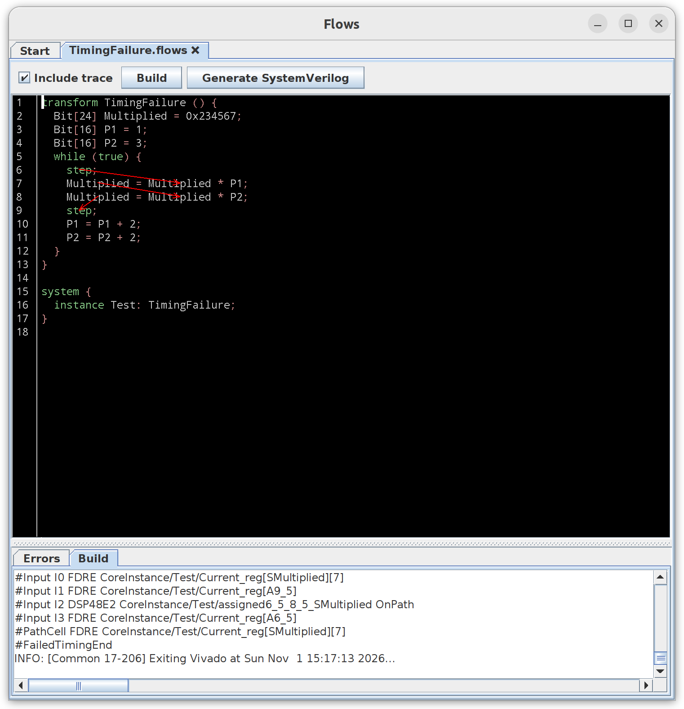
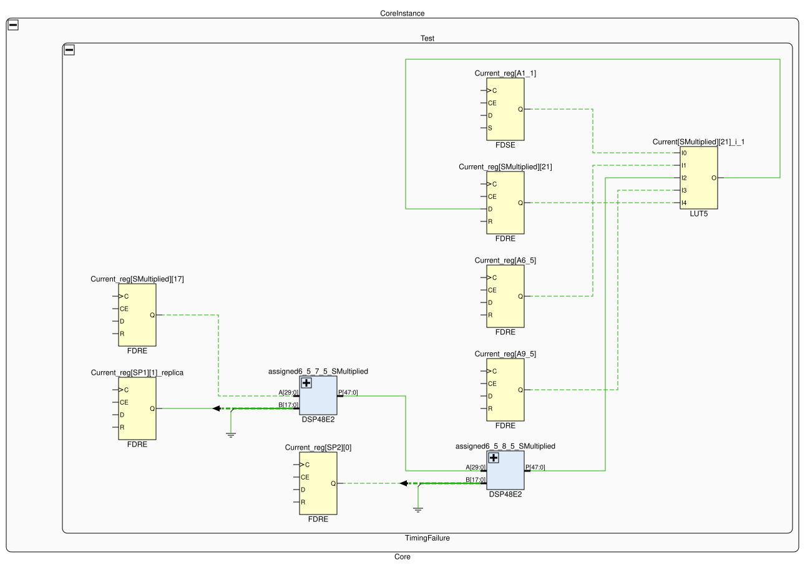
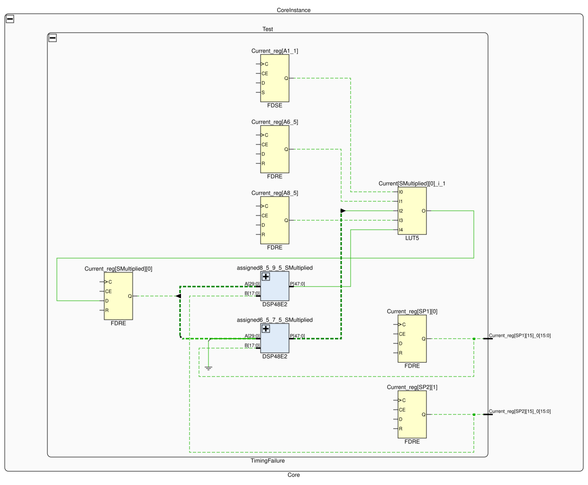

# Mapping timing failures to source

Consider this example:

```
  1  transform TimingFailure () {
  2    Bit[24] Multiplied = 0x234567;
  3    Bit[16] P1 = 1;
  4    Bit[16] P2 = 3;
  5    while (true) {
  6      step;
  7      Multiplied = Multiplied * P1;
  8      Multiplied = Multiplied * P2;
  9      step;
 10      P1 = P1 + 2;
 11      P2 = P2 + 2;
 12    }
 13  }
 14  
 15  system {
 16    instance Test: TimingFailure;
 17  }
 18  
```

If we try to build it as is, we get this message:

```
The highlighted path takes about 36% longer than one step allows.
Please review the highlighted path and split it into multiple steps.
```



What does it mean?

## Brief introduction to how FPGAs work

FPGAs work by connecting individual building blocks (some hold data, some combine signals and produce another set of
signals) through an internal network. Any given collection of blocks typically runs at a fixed frequency (322 MHz for
Flows core logic), giving a certain budget for a signal to propagate from each register to the next register (1/322 MHz
~= 3.1 ns). Because in multiplication most output bits depend on many input bits in a complex way, the signal has to
travel through two multiplier blocks and propagate in stable form in time to the next register for logic to work
reliably. In the example above, the result of first multiplication feeds into the second multiplication so it produces a
sequential path that every bit of `Multiplied` register must travel in order to implement the program.



Flows maps the message from Vivado back to the source code and points to the path that takes longer than one clock cycle 
at 322 MHz allows. This shows the key idea of Flows - simply moving `step` statement one line up moves the part of
computation (second multiplication) to the next cycle while preserving the correctness.

```
  1  transform TimingFailure () {                  transform TimingFailure () {
  2    Bit[24] Multiplied = 0x234567;                Bit[24] Multiplied = 0x234567;
  3    Bit[16] P1 = 1;                               Bit[16] P1 = 1;
  4    Bit[16] P2 = 3;                               Bit[16] P2 = 3;
  5    while (true) {                                while (true) {
  6      step;                                         step;
  7      Multiplied = Multiplied * P1;                 Multiplied = Multiplied * P1;
  8      Multiplied = Multiplied * P2;      →          step;
  9      step;                              →          Multiplied = Multiplied * P2;
 10      P1 = P1 + 2;                                  P1 = P1 + 2;
 11      P2 = P2 + 2;                                  P2 = P2 + 2;
 12    }                                             }
 13  }                                             }
 14  
 15  system {                                      system {
 16    instance Test: TimingFailure;                 instance Test: TimingFailure;
 17  }                                             }
```

The loop still takes two cycles per iteration. Before, one cycle did both multiplications and the other only two
additions; now each cycle does one multiplication, and the additions share the second.

The compiler then automatically adjusts the FSM structure and produces SystemVerilog that passes the timing
requirements. Note in the updated schematic that the hardware produces two values at once:

* `<Multiplied as of line 6>*P1`
* `<Multiplied as of line 8>*P2`

The final value is then selected based on which step the Flows program is on - either line 6 or line 8. The result is
the same, because the value at the start of the second cycle already includes the multiplication by P1. What changed is
that each cycle now contains only one multiplication, which fits within the clock period.


